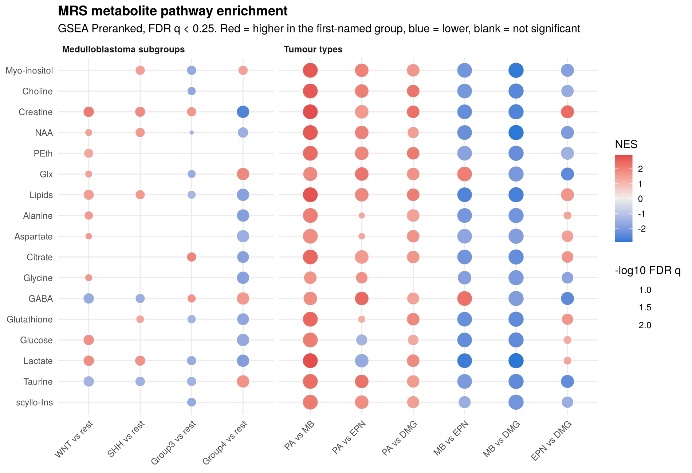
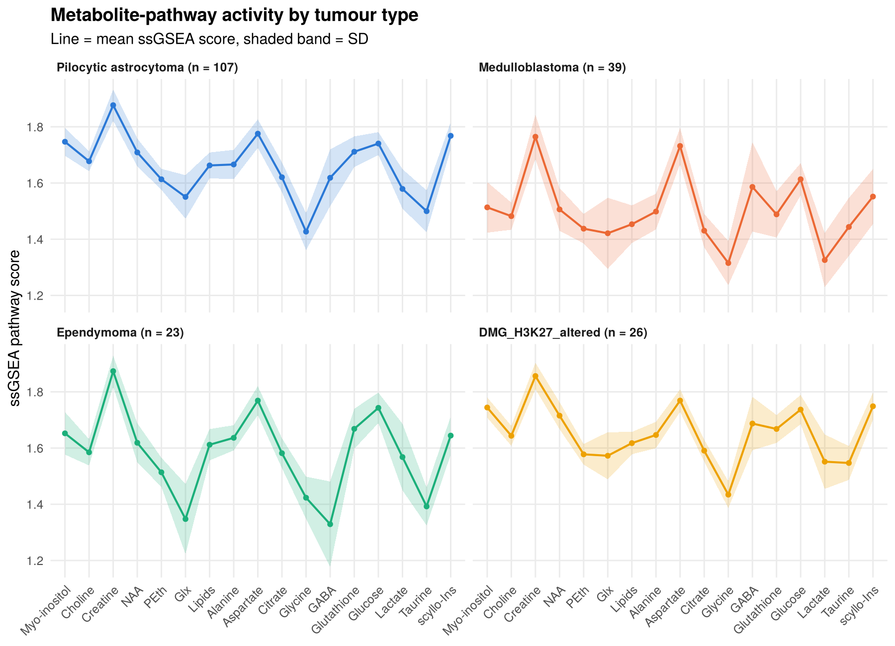
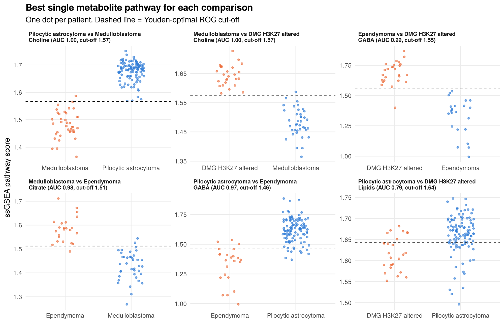
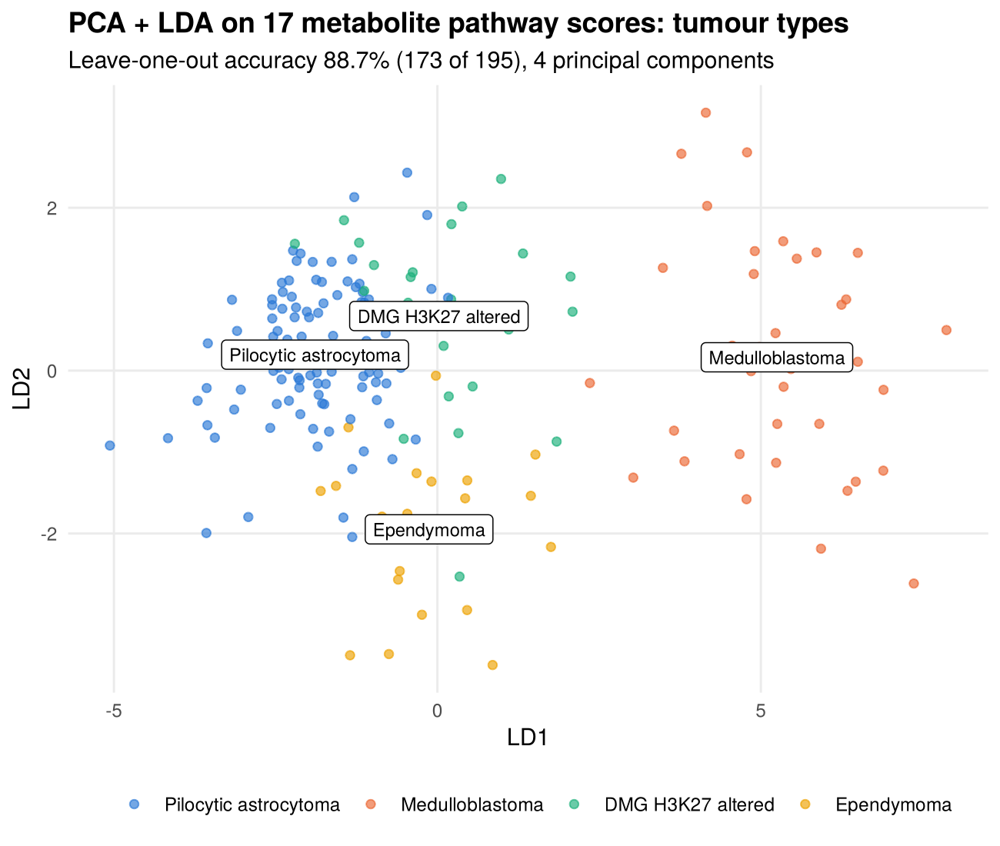
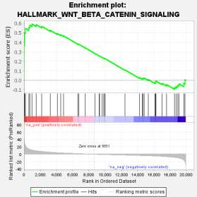
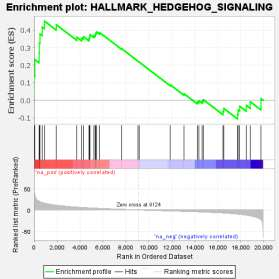
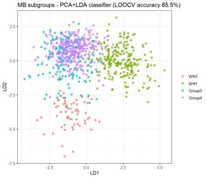

# Transcriptional signatures of ¹H-MRS metabolites in paediatric brain tumours

Code and gene sets from my MSc Bioinformatics dissertation at the University of Birmingham, supervised by Dr John Apps.

## What this project is about

¹H-MRS (proton magnetic resonance spectroscopy) measures metabolites such as choline, creatine, NAA and lactate inside a brain tumour without a biopsy, and the metabolite pattern differs between tumour types. What MRS cannot tell you is *why* a metabolite is high or low.

So I asked: **are the metabolite differences seen on MRS also visible in gene expression?**

To test that I:

1. built a panel of **138 gene sets for 17 MRS-detectable metabolites**, curated by hand from MSigDB
2. ran differential expression in two public cohorts
3. tested the panel with GSEA Preranked
4. scored every patient for every metabolite pathway with ssGSEA
5. checked how well those scores separate tumours, one metabolite at a time (ROC) and all together (PCA + LDA)

## Data

| Cohort | Accession | Type | Samples | Groups |
|---|---|---|---|---|
| Paediatric CNS tumours | [E-MTAB-14038](https://www.ebi.ac.uk/biostudies/arrayexpress/studies/E-MTAB-14038) | RNA-seq counts | 195 | Pilocytic astrocytoma 107, medulloblastoma 39, DMG H3K27-altered 26, ependymoma 23 |
| Medulloblastoma | [GSE85217](https://www.ncbi.nlm.nih.gov/geo/query/acc.cgi?acc=GSE85217) | Affymetrix microarray | 763 | WNT 70, SHH 223, Group 3 144, Group 4 326 |

E-MTAB-14038 is a pan-cancer cohort of about 1,700 samples; I only used the four tumour types above. The 195 sample IDs and their diagnoses are in [`data/sample_design.csv`](data/sample_design.csv). GSE85217 is downloaded by the limma script.

Both datasets are public. The expression data itself is not stored here, see [`data/README.md`](data/README.md).

## The gene set panel

[`data/gene_sets/MRS_Metabolite_GeneSets_v4.xlsx`](data/gene_sets/MRS_Metabolite_GeneSets_v4.xlsx) is the workbook I curated. For every gene set it lists the metabolite, why I included it, the MSigDB link and the genes. The same panel in GSEA format is `MRS_Metabolite_GeneSets_suffix.gmt`. Each gene set name ends in a metabolite code (`_CHO`, `_MI`, `_NAA` ...).

| Metabolite | Sets | Metabolite | Sets | Metabolite | Sets |
|---|---|---|---|---|---|
| Myo-inositol | 10 | Lipids / macromolecules | 10 | Glutathione | 10 |
| Choline | 10 | Alanine | 8 | Glucose | 8 |
| Creatine | 9 | Aspartate | 7 | Lactate | 6 |
| NAA | 8 | Citrate | 7 | Taurine | 9 |
| Phosphoethanolamine | 6 | Glycine | 9 | scyllo-Inositol | 4 |
| Glx | 8 | GABA | 9 | **Total** | **138** |

4,158 unique genes in total, between 15 and 406 genes per set.

## Scripts

Run them in order from the repository root, for example `Rscript scripts/03_deseq2_pairwise_tumour_types.R`.

| Script | What it does |
|---|---|
| `01_build_gene_set_gmt.R` | Turns the Excel workbook into the `.gmt` file |
| `02_fix_gene_symbols.R` | Repairs 27 gene symbols that Excel had turned into dates (`1-Mar`, `2-Sep` ...) in the counts matrix |
| `03_deseq2_pairwise_tumour_types.R` | DESeq2, six pairwise tumour-type comparisons, ranked by Wald statistic |
| `04_limma_medulloblastoma_subgroups.R` | Downloads GSE85217; limma, each subgroup vs the rest, ranked by moderated t; marker-gene check |
| `05_gsea_preranked.R` | GSEA Preranked of all ten ranked lists against the 138 gene sets |
| `06_hallmark_check.R` | Positive control: Hallmark WNT and Hedgehog sets in the WNT and SHH subgroups |
| `07_ssgsea_roc_analysis.R` | ssGSEA score per patient per metabolite, then ROC / AUC / Youden cut-off |
| `08_pca_lda_classifier.R` | PCA + LDA classifier with leave-one-out cross-validation |
| `09_figures.R` | Figures |
| `exploratory/deseq2_one_vs_rest.R` | My first DESeq2 attempt (one vs rest). Replaced by the pairwise design, kept for the record |

R packages: `DESeq2`, `limma`, `edgeR`, `GEOquery`, `org.Hs.eg.db`, `fgsea`, `GSVA`, `pROC`, `MASS`, `ggplot2`, `readxl`.

### Settings

| Step | Setting |
|---|---|
| Gene filter (RNA-seq) | at least 10 reads in at least 3 samples, applied within each pair |
| Differential expression | BH-adjusted p < 0.05 |
| Ranking metric | DESeq2 Wald statistic, limma moderated t |
| GSEA | 1,000 permutations, gene set size 15 to 500, no collapse, FDR q < 0.25 |
| ssGSEA input | log-CPM after TMM (RNA-seq), log2 intensity (microarray) |
| ssGSEA gene lists | all gene sets of one metabolite merged into one list, so 17 lists |
| Classifier | standardise, PCA to 95% variance, LDA, leave-one-out |

## Results

### Tumour types

Pilocytic astrocytoma has the highest metabolite-pathway activity and medulloblastoma the lowest, across almost every metabolite. Ependymoma and DMG sit in between and differ from each other mainly in the neurotransmitter pathways (GABA, Glx, taurine).

| Comparison | Metabolites up | Metabolites down |
|---|---|---|
| Pilocytic astrocytoma vs medulloblastoma | 17 | 0 |
| Pilocytic astrocytoma vs ependymoma | 15 | 2 |
| Pilocytic astrocytoma vs DMG | 16 | 0 |
| Medulloblastoma vs ependymoma | 2 | 15 |
| Medulloblastoma vs DMG | 0 | 17 |
| Ependymoma vs DMG | 8 | 9 |

The strongest single gene sets were the lactate-linked hypoxia set in pilocytic astrocytoma vs medulloblastoma (NES +2.87) and the NAA-linked oligodendrocyte differentiation set in medulloblastoma vs DMG (NES −2.91).

### How well does one metabolite pathway separate two tumour types?

| Comparison | Best pathway | AUC | Sensitivity | Specificity |
|---|---|---|---|---|
| Pilocytic astrocytoma vs medulloblastoma | Choline | 1.00 | 1.00 | 0.97 |
| Medulloblastoma vs DMG | Choline | 1.00 | 0.97 | 1.00 |
| Ependymoma vs DMG | GABA | 0.99 | 1.00 | 0.96 |
| Medulloblastoma vs ependymoma | Citrate | 0.98 | 0.95 | 0.96 |
| Pilocytic astrocytoma vs ependymoma | GABA | 0.97 | 0.93 | 0.87 |
| Pilocytic astrocytoma vs DMG | Lipids | 0.79 | 0.76 | 0.73 |

### Classifier

Using only the 17 pathway scores, PCA + LDA classified **173 of 195 tumours correctly (88.7%)** under leave-one-out cross-validation. Medulloblastoma is almost never confused with anything else (38 of 39). The weak point is DMG, which is often called pilocytic astrocytoma (11 of 26), which fits the low AUC for that pair above.

### Medulloblastoma subgroups

The subgroup differences are real but smaller than the tumour-type differences. WNT and SHH lean towards higher metabolite-pathway activity, Group 3 and Group 4 towards lower. Creatine is the clearest signal: up in WNT (NES +2.14) and strongly down in Group 4 (NES −2.60).

The marker check behaves as expected: AXIN2 and NKD1 are in the top 10 genes for WNT vs rest, and GLI1 and PTCH1 in the top 75 for SHH vs rest.

From the dissertation, for the parts that need the full GSE85217 expression matrix:

| | Result |
|---|---|
| Hallmark WNT/β-catenin in WNT | NES +1.91, FDR 0.0024 |
| Hallmark Hedgehog in SHH | NES +1.46, FDR 0.034 |
| Best single pathway, Group 4 vs rest | Creatine, AUC 0.90 |
| Best single pathway, WNT vs rest | Glycine, AUC 0.88 |
| Best single pathway, SHH vs rest | Citrate, AUC 0.83 |
| Best single pathway, Group 3 vs rest | Myo-inositol, AUC 0.82 |
| PCA + LDA, four subgroups | 85.5% (652 of 763) |

Figures for these, taken from the dissertation:

| Hallmark WNT/β-catenin, WNT vs rest | Hallmark Hedgehog, SHH vs rest |
|---|---|
|  |  |

For comparison, Gill et al. (2024) reached similar accuracy using the measured MRS metabolite concentrations themselves.

## About the numbers in this repository

- **ssGSEA scores and ROC tables** in `results/ssGSEA_ROC/` are the output files from my dissertation run.
- **Classifier:** `results/PCA_LDA/` is produced by script 08 from those scores and gives the dissertation result exactly (173 of 195).
- **GSEA:** for the dissertation I ran the ranked lists through the GSEA desktop software (Preranked tool). Script 05 does the same test with the `fgsea` package so that it can be re-run from the command line, and `results/GSEA/` holds its output. NES values agree with the dissertation to within about 0.05. FDR values, and the up/down call for a few metabolites, differ slightly because the two programs estimate FDR differently.
- **Ranked lists** in `results/*_rnk_files/` are the DESeq2 and limma outputs that went into GSEA.
- If you re-run script 07 with a different GSVA version, the ssGSEA scores can shift by about 0.01. AUCs move by at most about 0.01 and the classifier result does not change.

## Limitations

- Gene expression is only a proxy for a metabolite level. It says nothing about transport, enzyme activity or how fast the metabolite is used up. Taurine is a good example: its pathways come out low in medulloblastoma here, while MRS studies report high taurine.
- I merged all gene sets of a metabolite into one list without considering direction. Breakdown pathways could move opposite to synthesis pathways and cancel part of the signal. Giving each set a sign before merging is the first thing I would change.
- The two cohorts are separate, some groups are small, and the classifier has not been tested on outside data.
- Nobody in these cohorts has both MRS and RNA data. Paired data from the same patients is what would really test the idea.

## References

- Gill SK et al. Characterisation of paediatric brain tumours by their MRS metabolite profiles. *NMR Biomed* 2024;37:e5101.
- Wallis FSA et al. M&M: an RNA-seq based pan-cancer classifier for paediatric tumours. *eBioMedicine* 2024;111:105506.
- Cavalli FMG et al. Intertumoral heterogeneity within medulloblastoma subgroups. *Cancer Cell* 2017;31:737-754.
- Subramanian A et al. Gene set enrichment analysis. *PNAS* 2005;102:15545-15550.
- Liberzon A et al. The MSigDB hallmark gene set collection. *Cell Syst* 2015;1:417-425.
- Love MI, Huber W, Anders S. DESeq2. *Genome Biol* 2014;15:550.
- Ritchie ME et al. limma. *Nucleic Acids Res* 2015;43:e47.
- Hänzelmann S, Castelo R, Guinney J. GSVA. *BMC Bioinformatics* 2013;14:7.
- Robin X et al. pROC. *BMC Bioinformatics* 2011;12:77.
- Ziemann M, Eren Y, El-Osta A. Gene name errors are widespread in the scientific literature. *Genome Biol* 2016;17:177.

## Contact

Asha Jyothi Avanigadda, MSc Bioinformatics, University of Birmingham
